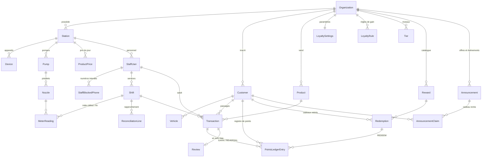

# Modèle de données — OLA STATION

La source de vérité est [`api/prisma/schema.prisma`](../api/prisma/schema.prisma). Ce document en donne une vue lisible.

## Vue d'ensemble

## Les tables, en une phrase chacune

### Structure
| Table | Rôle |
|---|---|
| `Organization` | Une enseigne (ex. Ola Latrie). Toutes les données sont cloisonnées par enseigne. |
| `Station` | Une station-service de l'enseigne. |
| `Device` | Un téléphone de la station, enrôlé par le gérant, partagé par les pompistes. |
| `Pump` / `Nozzle` | Les pompes et leurs pistolets. Un pistolet = un produit = un compteur. |

### Personnes
| Table | Rôle |
|---|---|
| `StaffUser` | Personnel : super-admin, admin d'enseigne, gérant, pompiste, caissier. Connexion à l'app par code court + PIN. |
| `StaffBlockedPhone` | Numéros qu'un pompiste n'a pas le droit de créditer (le sien, ses proches). |
| `Customer` | Client fidélité. Identifié par son numéro, avec un PIN et un jeton QR. |
| `Vehicle` | Véhicule du client. Son type fixe le plafond de litres par passage. |

### Prix et passages
| Table | Rôle |
|---|---|
| `Product` | Super, Gasoil, Boutique, Lavage… En litres ou au montant. |
| `ProductPrice` | Prix par station, avec historique. Le prix appliqué est recopié dans chaque passage. |
| `Transaction` | Un passage : qui, où, quand, quoi, combien, confirmé comment, points gagnés. |
| `Shift` / `MeterReading` | Service d'un pompiste, avec les index des compteurs au début et à la fin. |
| `ReconciliationLine` | Résultat du rapprochement : litres pompés vs litres fidélité, par produit. |

### Fidélité
| Table | Rôle |
|---|---|
| `LoyaltySettings` | Tous les paramètres réglables (seuils, plafonds, délais). |
| `LoyaltyRule` | Combien de points pour quel produit. |
| `Tier` | Niveaux Bronze / Silver / Gold. |
| `PointsLedgerEntry` | Registre des points. On ajoute, on ne modifie jamais. |
| `Reward` / `Redemption` | Catalogue de cadeaux et cadeaux retirés. |

### Relation client
| Table | Rôle |
|---|---|
| `Review` | Avis privé sur un passage, lié au pompiste. |
| `Announcement` | Offre, événement ou info, avec ciblage par station et niveau. |
| `AnnouncementClaim` | Cadeau d'événement remis (une fois par client). |
| `Notification` | Journal des push / SMS / WhatsApp envoyés, avec leur coût. |

### Sécurité
| Table | Rôle |
|---|---|
| `OtpChallenge` | Codes SMS envoyés (hachés), avec expiration et nombre d'essais. |
| `FraudAlert` | Alertes anti-fraude pour le gérant. |
| `AuditLog` | Journal de toutes les opérations sensibles. |

## Garanties portées par la base

| Garantie | Comment |
|---|---|
| Un passage n'est jamais compté deux fois (même après coupure réseau) | `Transaction.id` généré par l'appareil, clé primaire |
| Les points d'un passage ne sont attribués qu'une fois | `@@unique([transactionId, type])` sur le registre |
| Un seul avis par passage | `Review.transactionId @unique` |
| Un cadeau d'événement une seule fois par client | `@@unique([announcementId, customerId])` |
| Un client unique par numéro et par enseigne | `@@unique([organizationId, phone])` |
| L'historique ne change pas quand le prix change | Prix recopié dans `Transaction.unitPriceXof` |
| Une enseigne ne voit pas les données d'une autre | `organizationId` partout + Row-Level Security PostgreSQL |
